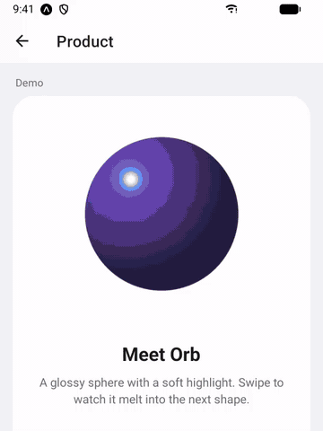

# expo-morph-carousel

**English** | [Tiếng Việt](https://github.com/anhtuank7c/expo-morph-carousel/blob/main/README.vi.md)

A carousel for Expo in which the images melt into each other like liquid while the pages slide. Built with React Native Skia and Reanimated 4, with presets for plainer transitions, loop, autoplay, vertical paging, screen reader support and web.

<p align="center">
  
</p>

## Features

- **Liquid morph.** Between two pages the current image dissolves into a blob and reforms as the next one. The effect is drawn with Skia on the UI thread and fades out completely when a page is at rest, so a settled image is never blurred.
- **Presets and custom effects.** `crossfade`, `slide`, `parallax`, `stack`, or your own worklet that maps a page offset to opacity and transforms.
- **Pager behavior you would expect.** Snap to page, one page per swipe, fling, rubber band at the ends, `loop` in both directions, horizontal or `vertical`, right-to-left layouts.
- **Autoplay** that pauses while the carousel is touched and while a screen reader is on.
- **Control from code.** `ref.scrollTo(index)`, `next()`, `prev()`, `onIndexChange`, a shared value that mirrors the position for your own animations, and a footer render prop with the current item.
- **Morphing pagination dots** that follow the finger and can be tapped.
- **Images.** Local `require()` or remote `{ uri }`, `contain` or `cover`, a placeholder color per item, neighbors kept loaded so a swipe rarely waits.
- **Image cache with expiry.** Remote images are stored on disk (Cache Storage on web) with a lifetime from `maxAge` or the server's `Cache-Control`. `stale-while-revalidate` by default: cached images show instantly, expired ones are revalidated with `ETag` (a 304 costs no image bytes) and swapped when the server has a new version.
- **Accessibility.** The carousel is one adjustable element: swipe up or down with VoiceOver or TalkBack to change page, and the current item is announced. Arrow keys, Home and End on web. Reduce Motion switches the effect to a cross-fade.
- **iOS, Android and web.** Runs in Expo Go.

## Installation

```bash
npx expo install expo-morph-carousel @shopify/react-native-skia expo-file-system \
  react-native-reanimated react-native-worklets react-native-gesture-handler
```

Two of these are optional:

| Package | Needed for | Without it |
| --- | --- | --- |
| `@shopify/react-native-skia` | The `liquid` effect (the default) | The carousel uses `crossfade` |
| `expo-file-system` | The disk cache for remote images on iOS and Android | Remote images load from the network each time (the platform's HTTP cache still applies) |

`babel.config.js` must use `babel-preset-expo`, which enables the worklets Babel plugin. Wrap the app in `GestureHandlerRootView`.

### Web

Skia runs on CanvasKit on web, a WebAssembly file that has to be served by your app. Copy it into `public/` once:

```bash
npx setup-skia-web public
```

The carousel loads CanvasKit in the background and shows a cross-fade until it is ready. To load the file from somewhere else, call `configureSkiaWeb({ locateFile: (file) => 'https://…/' + file })` before the first carousel renders.

## Compatibility

| | Supported |
| --- | --- |
| Expo SDK | 58 or later |
| React Native | 0.80 or later (New Architecture) |
| Reanimated | 4 or later, with `react-native-worklets` |
| React Native Skia | 2 or later (optional) |
| Platforms | iOS, Android, web |
| Expo Go | Yes. The package has no native code of its own |

## Usage

```tsx
import { MorphCarousel } from 'expo-morph-carousel';

const products = [
  { id: 'watch', title: 'Watch', description: '…', image: require('./assets/watch.png') },
  { id: 'phone', title: 'Phone', description: '…', image: require('./assets/phone.png') },
  { id: 'laptop', title: 'Laptop', description: '…', image: { uri: 'https://…/laptop.png' } },
];

export function Showcase() {
  return (
    <MorphCarousel
      data={products}
      keyExtractor={(p) => p.id}
      getImage={(p) => p.image}
      getAccessibilityLabel={(p) => p.title}
      style={{ height: 520, borderRadius: 28, backgroundColor: '#fff' }}
      renderItem={({ item }) => (
        <View style={{ alignItems: 'center', padding: 24, gap: 8 }}>
          <Text style={{ fontSize: 24, fontWeight: '700' }}>{item.title}</Text>
          <Text style={{ textAlign: 'center' }}>{item.description}</Text>
        </View>
      )}
      renderFooter={({ item, next }) => <Button title="Continue" onPress={next} />}
    />
  );
}
```

The carousel needs a size: give `style` a `height` or `flex: 1`. The media area takes `mediaHeight` at the top (or the whole carousel with `mediaPosition="background"`), the pages take the rest, and the dots and footer sit below.

The liquid effect works best with images on a transparent background, such as product shots, icons or illustrations, where the outline of the object changes between pages. With photos (`mediaFit="cover"`) it melts whole rectangles into each other.

## Props

| Prop | Default | Description |
| --- | --- | --- |
| `data` | required | Items |
| `getImage(item, index)` | required | Image for the media area: `require(...)` or `{ uri }` |
| `renderItem({ item, index })` | | Page content that slides with the gesture |
| `keyExtractor(item, index)` | index | Stable key for each item |
| `effect` | `'liquid'` | `'liquid'`, `'crossfade'`, `'slide'`, `'parallax'`, `'stack'` or a worklet function (see below) |
| `liquid` | | `{ blur = 28, threshold = 0.5, sharpness = 24 }`. Larger `blur` gives a rounder blob; lower `threshold` keeps more of the halo |
| `mediaPosition` | `'top'` | `'top'` or `'background'` |
| `mediaHeight` | `280` | Height of the media area when it is at the top |
| `mediaFit` | `'contain'` | `'contain'` or `'cover'` |
| `mediaPadding` | `16` | Space around the image inside the media area |
| `getPlaceholderColor(item, index)` | | Color of the soft blob shown while an image loads |
| `imageCache` | on | Options for remote images (see [Remote images and caching](#remote-images-and-caching)), or `false` |
| `direction` | `'horizontal'` | `'horizontal'` or `'vertical'` |
| `loop` | `false` | Swipe past the last page to the first, and back |
| `initialIndex` | `0` | Page shown first |
| `autoplay` | `false` | `true` or `{ interval = 4000, reverse = false, whenScreenReaderEnabled = false }` |
| `windowSize` | `2` | Pages rendered and images kept loaded on each side of the current page |
| `spring` | | `{ damping, stiffness, mass }` for the snap animation |
| `gestureEnabled` | `true` | Allow swiping. `ref` navigation works either way |
| `pagination` | `true` | `false`, or options: `activeColor`, `inactiveColor`, `size`, `activeWidth`, `gap`, `pressable`, `style` |
| `renderFooter(api)` | | Content under the dots. Gets `item`, `index`, `count`, `position`, `scrollTo`, `next`, `prev` |
| `onIndexChange(index)` | | Called when the nearest page changes, also during a drag |
| `positionValue` | | A `SharedValue<number>` that mirrors the position in pages |
| `accessibilityLabel` | `'Carousel'` | Screen reader label of the carousel |
| `getAccessibilityLabel(item, index)` | key | Screen reader text for the current item |
| `ref` | | `{ scrollTo(index, { animated }), next(), prev(), getIndex() }` |
| `style`, `mediaStyle`, `pageStyle`, `footerStyle`, `testID` | | |

## Remote images and caching

Remote images (`{ uri: 'https://…' }`) go through a disk cache that is on by default. Each image is stored with the time it was fetched and when it expires.

```tsx
// A module constant (or useMemo): the carousel memoizes the options on identity.
const CACHE = {
  strategy: 'stale-while-revalidate', // default
  maxAge: 6 * 60 * 60 * 1000, // 6 hours when the server sends no Cache-Control
} as const;

<MorphCarousel imageCache={CACHE} getImage={(p) => ({ uri: p.imageUrl })} … />
```

| Strategy | Cached and fresh | Cached and expired | Not cached |
| --- | --- | --- | --- |
| `stale-while-revalidate` (default) | Shown, no request | Shown at once, revalidated in the background, swapped if the server has a new version. Past `maxStale` it waits for the network instead | Downloaded |
| `cache-first` | Shown, no request | Waits for the network; the old copy is the fallback when offline | Downloaded |
| `network-first` | Revalidated before showing; the cached copy is the fallback when offline | Same | Downloaded |

How long an image is fresh:

- If the server sends `Cache-Control: max-age` (or `Expires`), that lifetime is used. `no-cache` means "always revalidate", `no-store` means "do not write it to disk". Set `respectHttpHeaders: false` to always use `maxAge`.
- Otherwise `maxAge` (default 24 hours).

Revalidation sends `If-None-Match` / `If-Modified-Since`. When the image has not changed, the server answers 304 and no image data is transferred. When it has changed, the new file gets a new name, so the image view reloads, and the old file is deleted. An image that stays on screen is revalidated when it expires, not only when it mounts.

Options of `imageCache`:

| Option | Default | Description |
| --- | --- | --- |
| `strategy` | `'stale-while-revalidate'` | See the table above |
| `maxAge` | 24 h | Lifetime in ms when the server sends none |
| `maxStale` | 7 days | How long past expiry `stale-while-revalidate` may still show an old image while the new one loads |
| `respectHttpHeaders` | `true` | Use `Cache-Control` / `Expires` and honor `no-store` |
| `headers` | | Request headers, for example `Authorization` |
| `getCacheKey(url)` | the URL | For signed URLs whose query changes on every request: `(url) => url.split('?')[0]` |

Pass `imageCache={false}` to load straight from the network.

The cache is shared by all carousels and has a programmatic API:

```ts
import { imageCache } from 'expo-morph-carousel';

imageCache.configure({ maxSize: 50 * 1024 * 1024, maxEntries: 300 }); // defaults: 100 MB, 500 files, LRU eviction
await imageCache.prefetch(urls); // warm up before the screen opens
imageCache.getEntry(url); // { fetchedAt, expiresAt, etag, size, … }
imageCache.stats(); // { hits, misses, revalidations, notModified, updates, errors, entries, size }
await imageCache.remove(url);
await imageCache.clear(); // for example on sign out
```

Files live in `<cache directory>/expo-morph-carousel/` on iOS and Android (the OS may clear it when storage is low) and in Cache Storage on web. Decoded images are also kept in memory (the last 24), so swiping back and forth does not decode them again.

To try it, the example app has a local image server that sends `ETag` and `Cache-Control` and can swap its images:

```bash
npm run image-server --workspace example   # http://localhost:8090, max-age 30 s
adb reverse tcp:8090 tcp:8090               # Android emulator
```

Open "Remote images" in the example app. The panel shows when the current image was fetched, how long it stays fresh, and the cache counters; "Swap images on server" changes what every URL returns.

## Controlling the carousel

```tsx
const carousel = useRef<MorphCarouselRef>(null);
const position = useSharedValue(0);

// Tint the screen with the current item's color while swiping
const background = useAnimatedStyle(() => ({
  backgroundColor: interpolateColor(position.value, [0, 1, 2], ['#efe9ff', '#fff3df', '#e2f6f1']),
}));

<MorphCarousel ref={carousel} positionValue={position} onIndexChange={setIndex} … />
<Button title="Next" onPress={() => carousel.current?.next()} />
```

`next()` on the last page goes back to the first when `loop` is off, which is what "Next" buttons and autoplay usually want. With `loop`, `scrollTo(0)` from the last page moves forward one page instead of rewinding through all of them.

## Custom effects

An effect gets the signed distance of an image's page from the current position (`offset`: 0 in view, -1 one page back, 0.5 halfway to the next) and returns opacity and transforms. It runs on the UI thread, so it must be a worklet:

```tsx
import type { MediaEffectFn } from 'expo-morph-carousel';

const flip: MediaEffectFn = ({ offset }) => {
  'worklet';
  const angle = Math.max(-1, Math.min(1, offset)) * 90;
  return {
    opacity: Math.abs(offset) < 0.5 ? 1 : 0,
    transform: [{ perspective: 800 }, { rotateY: `${angle}deg` }],
  };
};

<MorphCarousel effect={flip} … />
```

The input also has `width`, `height`, `direction` and `rtl`. The built-in presets are exported as `mediaEffects` if you want to wrap one.

## Pagination outside the carousel

`<Pagination>` is exported. Pass it the same shared value:

```tsx
<MorphCarousel pagination={false} positionValue={position} ref={carousel} … />
<Pagination count={data.length} position={position} onPress={(i) => carousel.current?.scrollTo(i)} />
```

## How the liquid effect works

All images near the current page are stacked in one Skia layer and cross-fade by page offset. The layer then goes through two filters:

1. A blur whose radius peaks halfway between two pages. Both images melt into one soft shape.
2. An alpha threshold, a color matrix on the alpha channel, that cuts the blurred edge back to a sharp outline. The soft shape reads as a solid blob instead of a haze.

Both filters scale with a triangle curve that is 0 on a page and 1 halfway between two pages, so a page at rest is drawn untouched. The text pages are ordinary React Native views that slide; only the media area is drawn by Skia.

## Accessibility

- The media and the pages form one element with the role `adjustable` (`slider` on web). VoiceOver and TalkBack users swipe up or down to change page; the value reads as "Watch, 1 / 3".
- The footer stays outside that element, so buttons in it remain reachable.
- Autoplay stops while a screen reader is on, unless `autoplay.whenScreenReaderEnabled` is set.
- With Reduce Motion on, `liquid` and the other presets fall back to `crossfade`, and snapping is not animated.
- On web the carousel is focusable: arrow keys move one page (Up and Down when vertical), Home and End go to the ends.

## Performance

- Only `windowSize` pages on each side are rendered; the rest of `data` costs nothing.
- Gesture, snapping, effects and dots run on the UI thread. React re-renders only when the nearest page changes.
- The Skia filters are created only while a transition is in progress. At rest the layer is a plain image draw.
- Keep images close to the size they are shown at. A 4000 px photo blurred every frame is expensive on older Android phones; lower `liquid.blur` helps too.

## Troubleshooting

| Symptom | Cause and fix |
| --- | --- |
| Nothing shows | The carousel has no height. Set `style={{ height: … }}` or `flex: 1` inside a sized parent |
| Cross-fade instead of liquid | Skia is not installed, Reduce Motion is on, or (web) CanvasKit has not loaded yet. Check that `public/canvaskit.wasm` exists (`npx setup-skia-web public`) |
| Swiping scrolls the parent ScrollView instead | Horizontal carousels claim horizontal drags of more than 10 px; vertical drags go to the parent. In a vertical carousel inside a vertical ScrollView, give the carousel a fixed height and expect the two to compete |
| Worklet errors such as "… is not a worklet" | A custom effect is missing `'worklet';`, or `babel.config.js` does not use `babel-preset-expo`. Clear the Metro cache with `npx expo start -c` |
| Remote images stay as placeholders | The download failed; `imageCache.stats().errors` counts failures. On Android, HTTPS errors (for example a proxy certificate) show as `System.err` in logcat. Cleartext `http://` URLs need `usesCleartextTraffic` in a release build |
| An updated image on the server does not show up | It is still fresh: lower `maxAge`, send a shorter `Cache-Control: max-age` from the server, or call `imageCache.remove(url)` |

## Platform status

| Platform | Verified with |
| --- | --- |
| Android | Android 17 emulator (API 37), Expo Go: every effect, loop, vertical, dots, the ref API, and the disk cache with the local image server (fresh hits, 304 revalidation, swapped images after expiry, persistence across app restarts) |
| Web | Desktop Chrome: liquid effect with CanvasKit, keyboard navigation, remote images, the Cache Storage cache across page reloads |
| iOS | Not verified yet |

Reports from iOS are welcome.

## Development

```bash
npm install
npm run example          # example app in Expo Go
npm run check            # typecheck, ESLint, Prettier, unit tests
npm test                 # paging math unit tests only
npm run build            # compile to lib/
```

The example app (`example/`) imports the package from `src/` and has four screens: a product showcase, a full-screen onboarding, a playground for every option and a remote image gallery. Its shapes are generated with `npm run make-assets --workspace example` (needs ffmpeg).

`npm install` also sets up a pre-commit hook that runs ESLint and Prettier on staged files and the typecheck.

## Contributing and bug reports

- Bugs: open an issue with the [bug report form](https://github.com/anhtuank7c/expo-morph-carousel/issues/new?template=bug_report.yml).
- Ideas and questions: [feature request](https://github.com/anhtuank7c/expo-morph-carousel/issues/new?template=feature_request.yml) or [Discussions](https://github.com/anhtuank7c/expo-morph-carousel/discussions).
- Pull requests: see [CONTRIBUTING.md](https://github.com/anhtuank7c/expo-morph-carousel/blob/main/CONTRIBUTING.md).
- Security issues: see [SECURITY.md](https://github.com/anhtuank7c/expo-morph-carousel/blob/main/SECURITY.md).
- Release notes: [CHANGELOG.md](https://github.com/anhtuank7c/expo-morph-carousel/blob/main/CHANGELOG.md).

Also by the same author: [expo-morph-menu](https://github.com/anhtuank7c/expo-morph-menu), a floating button that morphs into a menu and into full-screen routes.

## License

MIT
