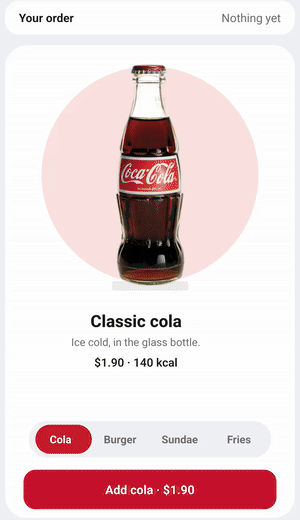
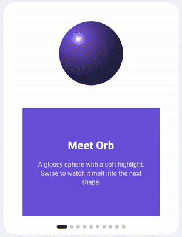
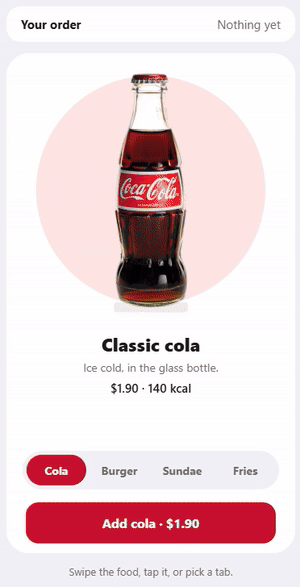
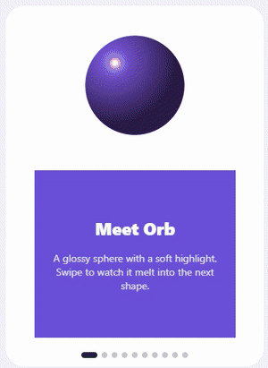

# expo-morph-carousel

**English** | [Tiếng Việt](https://github.com/anhtuank7c/expo-morph-carousel/blob/main/README.vi.md)

A carousel for Expo in which the images melt into each other like liquid while the pages slide. Built with React Native Skia and Reanimated 4, with presets for plainer transitions, loop, autoplay, vertical paging, screen reader support and web.

<table>
  <tr>
    <th></th>
    <th>Product showcase</th>
    <th>Food order</th>
    <th><code>cube</code> page effect</th>
  </tr>
  <tr>
    <th>Android</th>
    <td></td>
    <td></td>
    <td></td>
  </tr>
  <tr>
    <th>Web</th>
    <td></td>
    <td></td>
    <td></td>
  </tr>
</table>

Recorded from the example app on an Android emulator and in Chrome.

## Features

- **Liquid morph.** Between two pages the current image dissolves into a blob and reforms as the next one. The effect is drawn with Skia on the UI thread and fades out completely when a page is at rest, so a settled image is never blurred.
- **Presets and custom effects.** `crossfade`, `slide`, `parallax`, `stack`, or your own worklet that maps a page offset to opacity and transforms.
- **Pager behavior you would expect.** Snap to page, one page per swipe, fling, rubber band at the ends, `loop` in both directions, horizontal or `vertical`, right-to-left layouts.
- **Autoplay** that pauses while the carousel is touched and while a screen reader is on.
- **Control from code.** `ref.scrollTo(index)`, `next()`, `prev()`, `onIndexChange`, a shared value that mirrors the position for your own animations, and a footer render prop with the current item.
- **Page layouts** for whole cards: `parallax`, `stack`, `coverflow`, `cube`, `flip`, `fade`, `scale-fade`, `rotate`, `tinder`, or your own worklet; pages narrower than the carousel to show the neighbors; `page`, `momentum` or `free` snapping; spring or timing.
- **Slots** like expo-morph-menu: replace the pagination, each dot, or draw over and behind the media with your own components.
- **Morphing pagination dots** that follow the finger and can be tapped.
- **Images.** Local `require()` or remote `{ uri }`, `contain` or `cover`, a placeholder color per item, neighbors kept loaded so a swipe rarely waits.
- **Responsive images.** Give a list of sizes (`srcset`) or build CDN URLs from the measured size; the carousel picks the right one for the area and pixel ratio, and after a rotation cross-fades to a sharper one without a flash.
- **Image cache with expiry.** Remote images are stored on disk (Cache Storage on web) with a lifetime from `maxAge` or the server's `Cache-Control`. `stale-while-revalidate` by default: cached images show instantly, expired ones are revalidated with `ETag` (a 304 costs no image bytes) and swapped when the server has a new version.
- **Accessibility.** The carousel is one adjustable element: swipe up or down with VoiceOver or TalkBack to change page, and the current item is announced. Arrow keys, Home and End on web. Reduce Motion switches the effect to a cross-fade.
- **iOS, Android and web.** Runs in Expo Go.

## Installation

```bash
npx expo install expo-morph-carousel @shopify/react-native-skia expo-file-system \
  react-native-reanimated react-native-worklets react-native-gesture-handler
```

Two of these are optional:

| Package | Needed for | Without it |
| --- | --- | --- |
| `@shopify/react-native-skia` | The `liquid` effect (the default) | The carousel uses `crossfade` |
| `expo-file-system` | The disk cache for remote images on iOS and Android | Remote images load from the network each time (the platform's HTTP cache still applies) |

`babel.config.js` must use `babel-preset-expo`, which enables the worklets Babel plugin. Wrap the app in `GestureHandlerRootView`.

### Web

Skia runs on CanvasKit on web, a WebAssembly file that has to be served by your app. Copy it into `public/` once:

```bash
npx setup-skia-web public
```

The carousel loads CanvasKit in the background and shows a cross-fade until it is ready. To load the file from somewhere else, call `configureSkiaWeb({ locateFile: (file) => 'https://…/' + file })` before the first carousel renders.

## Compatibility

| | Supported |
| --- | --- |
| Expo SDK | 58 or later |
| React Native | 0.80 or later (New Architecture) |
| Reanimated | 4 or later, with `react-native-worklets` |
| React Native Skia | 2 or later (optional) |
| Platforms | iOS, Android, web |
| Expo Go | Yes. The package has no native code of its own |

## Usage

```tsx
import { MorphCarousel } from 'expo-morph-carousel';

const products = [
  { id: 'watch', title: 'Watch', description: '…', image: require('./assets/watch.png') },
  { id: 'phone', title: 'Phone', description: '…', image: require('./assets/phone.png') },
  { id: 'laptop', title: 'Laptop', description: '…', image: { uri: 'https://…/laptop.png' } },
];

export function Showcase() {
  return (
    <MorphCarousel
      data={products}
      keyExtractor={(p) => p.id}
      getImage={(p) => p.image}
      getAccessibilityLabel={(p) => p.title}
      style={{ height: 520, borderRadius: 28, backgroundColor: '#fff' }}
      renderItem={({ item }) => (
        <View style={{ alignItems: 'center', padding: 24, gap: 8 }}>
          <Text style={{ fontSize: 24, fontWeight: '700' }}>{item.title}</Text>
          <Text style={{ textAlign: 'center' }}>{item.description}</Text>
        </View>
      )}
      renderFooter={({ item, next }) => <Button title="Continue" onPress={next} />}
    />
  );
}
```

The carousel needs a size: give `style` a `height` or `flex: 1`. The media area takes `mediaHeight` at the top (or the whole carousel with `mediaPosition="background"`), the pages take the rest, and the dots and footer sit below.

The liquid effect works best with images on a transparent background, such as product shots, icons or illustrations, where the outline of the object changes between pages. With photos (`mediaFit="cover"`) it melts whole rectangles into each other.

## Props

| Prop | Default | Description |
| --- | --- | --- |
| `data` | required | Items |
| `getImage(item, index, target)` | | Image for the media area (no media area without it): `require(...)`, `{ uri }`, a list of `{ uri, width, height }` variants, or a URL built from `target` (see [Responsive images](#responsive-images-srcset)) |
| `renderItem({ item, index, offset })` | | Page content or a whole card. `offset` is this page's distance from the current position (shared value) |
| `pageEffect` | `'slide'` | How whole pages move: `'slide'`, `'parallax'`, `'stack'`, `'coverflow'`, `'cube'`, `'flip'`, `'fade'`, `'scale-fade'`, `'rotate'`, `'tinder'`, `pageEffects.<name>(options)` or a worklet (see [Page layouts](#page-layouts)) |
| `pageSize` | page area | Size of a page along the scroll axis; smaller shows the neighbors |
| `pageGap` | `0` | Space between pages |
| `pageAlign` | `'center'` | `'center'` or `'start'` |
| `snapMode` | `'page'` | `'page'`, `'momentum'` or `'free'` |
| `tapToNavigate` | `false` | `true` or `{ mode, backZone, area }` (`mode` `'sides'` or `'forward'`, `backZone` 0.3, `area` `'all'` or `'media'`): tap to change page (see [Tap to navigate](#tap-to-navigate)) |
| `animation` | spring | `{ type: 'spring', damping, stiffness, mass }` or `{ type: 'timing', duration }` |
| `components` | | Slots: `Pagination`, `Dot`, `MediaOverlay`, `MediaBackground` (see [Slots](#slots)) |
| `configureGesture(pan)` | | Adjust the pan gesture (thresholds, simultaneous gestures) and return it. Memoize it |
| `keyExtractor(item, index)` | index | Stable key for each item |
| `effect` | `'liquid'` | `'liquid'`, `'crossfade'`, `'slide'`, `'parallax'`, `'stack'` or a worklet function (see below) |
| `liquid` | | `{ blur = 28, threshold = 0.5, sharpness = 24, preserveShape = false, decode = 'scheduled' }`. Larger `blur` gives a rounder blob; lower `threshold` keeps more of the halo. `preserveShape` keeps the image rectangle sharp (no rounded corners) while only its content melts, for photos. `decode` picks when photos are decoded (see "How the liquid effect works") |
| `mediaPosition` | `'top'` | `'top'` or `'background'` |
| `mediaHeight` | `280` | Height of the media area when it is at the top |
| `mediaFit` | `'contain'` | `'contain'` or `'cover'` |
| `mediaPadding` | `16` | Space around the image inside the media area |
| `getPlaceholderColor(item, index)` | | Color of the soft blob shown while an image loads |
| `imageCache` | on | Options for remote images (see [Remote images and caching](#remote-images-and-caching)), or `false` |
| `direction` | `'horizontal'` | `'horizontal'` or `'vertical'` |
| `loop` | `false` | Swipe past the last page to the first, and back |
| `initialIndex` | `0` | Page shown first |
| `autoplay` | `false` | `true` or `{ interval = 4000, reverse = false, whenScreenReaderEnabled = false }` |
| `windowSize` | `2` | Pages rendered and images kept loaded on each side of the current page |
| `prefetch` | `1` | Pages beyond the window on each side whose images are downloaded ahead, at low priority |
| `gestureEnabled` | `true` | Allow swiping. `ref` navigation works either way |
| `pagination` | `true` | `false`, or options: `activeColor`, `inactiveColor`, `size`, `activeWidth`, `gap`, `pressable`, `style` |
| `renderFooter(api)` | | Content under the dots. Gets `item`, `index`, `count`, `position`, `scrollTo`, `next`, `prev` |
| `onIndexChange(index)` | | Called when the nearest page changes, also during a drag |
| `onScrollStart()` | | A swipe, a programmatic move or an autoplay step started |
| `onScrollEnd(index)` | | The carousel came to rest on `index` |
| `positionValue` | | A `SharedValue<number>` that mirrors the position in pages |
| `accessibilityLabel` | `'Carousel'` | Screen reader label of the carousel |
| `getAccessibilityLabel(item, index)` | key | Screen reader text for the current item |
| `ref` | | `{ scrollTo(index, { animated }), next({ count, animated }), prev({ count, animated }), getIndex() }` |
| `style`, `mediaStyle`, `pageStyle`, `footerStyle`, `testID` | | |

## Page layouts

Without `getImage` the carousel is a plain card carousel: `renderItem` is the whole card and `pageEffect` decides how cards move. With `getImage` the page effect moves the content under the media area.

The two kinds of effect are independent and combine: `effect` (default `liquid`) morphs the images in the media area, `pageEffect` moves the pages. The liquid morph stays the default; a page effect is added on top of it, never instead of it. The Layouts screen of the example shows the liquid images over cards that move with each page effect.

```tsx
import { MorphCarousel, pageEffects } from 'expo-morph-carousel';

<MorphCarousel
  data={cards}
  renderItem={({ item }) => <Card item={item} />}
  pageEffect="coverflow" // or pageEffects.coverflow({ angle: 60, spacing: 0.5 })
  pageSize={280} // narrower than the carousel: the neighbors show at the sides
  pageGap={12}
  style={{ height: 380 }}
/>
```

| Effect | Look | Options |
| --- | --- | --- |
| `slide` | Pages side by side | |
| `parallax` | Current page full size, neighbors smaller and closer. Use with `pageSize` | `scale` 0.84, `offset` 0, `opacity` 1 |
| `stack` | A deck: next cards wait behind, the current one slides off | `visible` 3, `spacing` 16, `scaleStep` 0.06, `opacityStep` 0.18, `rotation` 0, `stackAxis` `'across'` |
| `coverflow` | Neighbors turned away in 3D, overlapping | `angle` 48, `scale` 0.82, `spacing` 0.62 |
| `cube` | A solid cube turning: neighboring faces share their edge and the whole cube is seen through one perspective. Pages should fill their frame edge to edge (no margin, rounded corners or `pageGap`); a page narrower than the carousel leaves room for the near edge, which comes toward the eye | `perspective` 2.5 × the larger page side |
| `flip` | The card turns over in place; the next card is its back | |
| `fade` | Cross-fade in place | |
| `scale-fade` | Outgoing shrinks and fades, incoming settles from slightly larger | `scale` 0.86 |
| `rotate` | Pages swing on an arc | `angle` 14, `drop` 24 |
| `tinder` | Pile of cards; the top one is thrown off with a tilt | `visible` 2, `angle` 18 |

All effects work horizontally and vertically and mirror in right-to-left layouts. With Reduce Motion on, named effects fall back to `slide`.

Right-to-left follows `I18nManager.isRTL`: forward is to the left, swiping to the right moves forward, dots and tap zones are mirrored. In an Expo app, RTL layouts are only enabled with `"extra": { "supportsRTL": true }` in `app.json`.

A custom effect is a worklet from the page's offset to a style. It gets `offset` (0 in view, 1 next, -1 previous, fractions while moving), `step` (distance between pages), the page and viewport sizes, `direction` and `rtl`, and returns `opacity`, `zIndex`, `transform` and `transformOrigin`. It must include the translation:

```tsx
const door: PageEffectFn = ({ offset, step }) => {
  'worklet';
  const o = Math.max(-1, Math.min(1, offset));
  return {
    zIndex: Math.round(100 - Math.abs(offset) * 10),
    transformOrigin: o > 0 ? 'left center' : 'right center',
    transform: [{ perspective: 800 }, { translateX: offset * step }, { rotateY: `${o * -60}deg` }],
  };
};
```

`renderItem` also gets `offset` as a shared value, to animate a card's content separately from the card:

```tsx
renderItem={({ item, offset }) => <Card item={item} offset={offset} />}

// inside Card
const title = useAnimatedStyle(() => ({
  transform: [{ translateX: interpolate(offset.value, [-1, 0, 1], [-60, 0, 60]) }],
}));
```

## Snapping and animation

| `snapMode` | Behavior |
| --- | --- |
| `page` (default) | One page per swipe; a fling moves to the next page |
| `momentum` | A hard fling glides over several pages, then snaps to the nearest |
| `free` | Glides and stops anywhere, like a scroll view |

`animation` sets how the carousel settles, after a swipe and for `scrollTo`, `next`, dots and autoplay: a spring that carries the finger's velocity (default `{ damping: 26, stiffness: 220 }`) or `{ type: 'timing', duration }`.

`onScrollStart` fires when a swipe, a command or an autoplay step starts, `onScrollEnd(index)` when the carousel comes to rest. `configureGesture` receives the pan gesture to adjust it, for example to run together with a parent gesture:

```tsx
const configureGesture = useCallback((pan) => pan.simultaneousWithExternalGesture(parentPan), [parentPan]);
```

## Tap to navigate

Some users tap rather than swipe. With `tapToNavigate`, a tap changes the page:

```tsx
<MorphCarousel tapToNavigate … /> // left 30% back, the rest forward
<MorphCarousel tapToNavigate={{ mode: 'forward' }} … /> // any tap goes forward
<MorphCarousel tapToNavigate={{ area: 'media' }} … /> // only taps on the media area
```

| Option | Default | |
| --- | --- | --- |
| `mode` | `'sides'` | `sides`: the leading `backZone` goes back, the rest forward, like stories. `forward`: any tap goes forward |
| `backZone` | `0.3` | Fraction of the carousel that goes back |
| `area` | `'all'` | `media` counts only taps on the media area |

The leading side is the left, the top when vertical, the right in right-to-left layouts. With `pageSize` smaller than the carousel, a tap on a neighbor peeking at the side goes to that neighbor. Swiping keeps working: a tap counts only when the finger does not move, and a touch on a carousel at rest does not fire `onScrollEnd`.

It is off by default because a tap on a button inside a page would also change the page; with buttons in your pages, use `area: 'media'`.

## Slots

Like expo-morph-menu, the visible parts can be replaced with your own components through `components`. Each slot gets the carousel's `position` as a shared value, so it can animate with the finger on the UI thread.

| Slot | Props | Default |
| --- | --- | --- |
| `Pagination` | `count`, `index`, `position`, `loop`, `direction`, `scrollTo(i)` | Morphing dots. `null` hides the pagination |
| `Dot` | `index`, `count`, `active` (shared value 0–1), `direction`, `onPress` | Pill dot. Used by the built-in pagination |
| `MediaOverlay` | `item`, `index`, `count`, `position`, `width`, `height` | Nothing. Drawn over the media, not touchable |
| `MediaBackground` | same | Nothing. Drawn behind the media |

```tsx
function StoryPagination({ count, position, scrollTo }: PaginationSlotProps) {
  // one bar per page that fills as you swipe (see example/app/slots.tsx)
}

function NumberDot({ index, active, onPress }: DotSlotProps) {
  const style = useAnimatedStyle(() => ({ transform: [{ scale: 0.8 + active.value * 0.35 }] }));
  return (
    <Pressable onPress={onPress}>
      <Animated.View style={[styles.dot, style]}>
        <Text>{index + 1}</Text>
      </Animated.View>
    </Pressable>
  );
}

<MorphCarousel components={{ Pagination: StoryPagination, MediaOverlay: Caption, MediaBackground: Tint }} … />
```

`renderItem` and `renderFooter` are slots too: the page content and whatever sits under the pagination.

## Responsive images (srcset)

The carousel measures its media area, multiplies by the device pixel ratio and picks an image that is sharp enough without downloading more than needed. There are two ways to offer sizes.

**A list of variants**, the React Native form of `srcset` (`width` is the `w` descriptor):

```tsx
getImage={(p) => [
  { uri: `${p.base}-640.jpg`, width: 640, height: 480 },
  { uri: `${p.base}-1280.jpg`, width: 1280, height: 960 },
  { uri: `${p.base}-2560.jpg`, width: 2560, height: 1920 },
]}
```

The smallest variant at least as wide as needed wins; with `height` set, `cover` and `contain` account for the aspect ratio. A variant already in the cache is preferred when it is at most twice the needed width.

**A URL built for the size**, for image CDNs (imgix, Cloudinary, Unsplash, a Next.js-style resizer). The third argument is the target in physical pixels, rounded up to one of a few widths (`WIDTH_STEPS`: 320, 480, 640, 750, 828, 1080, 1200, 1440, 1920, 2560, …) so the CDN and the cache see a handful of URLs per image, not one per device:

```tsx
getImage={(p, i, target) => ({
  uri: `https://images.unsplash.com/photo-${p.id}?w=${target.width}&h=${target.height}&fit=crop`,
})}
```

`target` has `width`, `height`, `pixelRatio`, `layoutWidth`, `layoutHeight` (dp) and `fit`.

There is no `sizes`: HTML needs it because the browser chooses before layout, the carousel chooses after.

**Rotation and resizing.** When the area grows (portrait to landscape, a split-screen resize, a window on web), the sharper variant is downloaded in the background while the current image stays on screen, then cross-faded in over 220 ms once decoded. When the area shrinks, the sharper image already shown is kept and nothing is downloaded, like browsers do. There is never an empty frame. With the liquid effect, the image follows the new size one frame after the layout change (the re-render that reads it): measuring the canvas on the UI thread instead would cost a measurement in every frame for as long as the carousel is mounted.

## Remote images and caching

Remote images (`{ uri: 'https://…' }`) go through a disk cache that is on by default. Each image is stored with the time it was fetched and when it expires.

```tsx
// A module constant (or useMemo): the carousel memoizes the options on identity.
const CACHE = {
  strategy: 'stale-while-revalidate', // default
  maxAge: 6 * 60 * 60 * 1000, // 6 hours when the server sends no Cache-Control
} as const;

<MorphCarousel imageCache={CACHE} getImage={(p) => ({ uri: p.imageUrl })} … />
```

| Strategy | Cached and fresh | Cached and expired | Not cached |
| --- | --- | --- | --- |
| `stale-while-revalidate` (default) | Shown, no request | Shown at once, revalidated in the background, swapped if the server has a new version. Past `maxStale` it waits for the network instead | Downloaded |
| `cache-first` | Shown, no request | Waits for the network; the old copy is the fallback when offline | Downloaded |
| `network-first` | Revalidated before showing; the cached copy is the fallback when offline | Same | Downloaded |

How long an image is fresh:

- If the server sends `Cache-Control: max-age` (or `Expires`), that lifetime is used. `no-cache` means "always revalidate", `no-store` means "do not write it to disk". Set `respectHttpHeaders: false` to always use `maxAge`.
- Otherwise `maxAge` (default 24 hours).

Revalidation sends `If-None-Match` / `If-Modified-Since`. When the image has not changed, the server answers 304 and no image data is transferred. When it has changed, the new file gets a new name, so the image view reloads, and the old file is deleted. An image that stays on screen is revalidated when it expires, not only when it mounts.

Options of `imageCache`:

| Option | Default | Description |
| --- | --- | --- |
| `strategy` | `'stale-while-revalidate'` | See the table above |
| `maxAge` | 24 h | Lifetime in ms when the server sends none |
| `maxStale` | 7 days | How long past expiry `stale-while-revalidate` may still show an old image while the new one loads |
| `respectHttpHeaders` | `true` | Use `Cache-Control` / `Expires` and honor `no-store` |
| `headers` | | Request headers, for example `Authorization` |
| `getCacheKey(url)` | the URL | For signed URLs whose query changes on every request: `(url) => url.split('?')[0]` |

Pass `imageCache={false}` to load straight from the network.

### Load order and prefetching

Downloads go through one queue with a limit of parallel requests (4 by default) and three priorities:

| Priority | Used for |
| --- | --- |
| `high` | The image of the page in view |
| `normal` | Its neighbors (one page away) |
| `low` | Pages further away in the render window, prefetches, background revalidations |

When the user swipes, the images of the new page are moved up the queue, so a fast swipe does not wait behind downloads for pages already passed.

Beyond the render window (`windowSize`), the carousel downloads the images of `prefetch` more pages on each side (default 1) without rendering them, choosing the same variant the page will choose when it mounts. `prefetch={0}` turns it off.

To download images before the carousel exists (the next screen, a list item scrolling into view), use the hook or the function:

```tsx
import { imageTargetFor, usePrefetchImages, imageCache } from 'expo-morph-carousel';

// In the screen before: build the URLs the carousel will request
const target = imageTargetFor({ width: screenWidth - 32, height: 240 }, PixelRatio.get(), 'cover');
const { loaded, total, failed, done } = usePrefetchImages(
  products.map((p) => cdnUrl(p.image, target.width)),
  { priority: 'low' }, // default; `enabled: false` to wait
);

// Or imperatively, for example after a list request resolves
await imageCache.prefetch(urls, cacheOptions, 'low');
```

`imageTargetFor` is the function the carousel uses for `getImage`'s `target`, so the prefetched URL is the one the carousel asks for.

### Limits

| Setting | Default | |
| --- | --- | --- |
| `maxSize` | 100 MB | Bytes on disk. Least recently used files are deleted first |
| `maxEntries` | 500 | Files on disk |
| `maxConcurrent` | 4 | Parallel downloads; the rest wait in priority order |
| `decodedImages` | 24 | Decoded images kept in memory for the liquid effect. Each costs width × height × 4 bytes (a 1080×810 photo ≈ 3.5 MB), so 24 such photos ≈ 84 MB. Lower it for large photos on low-memory devices |
| `decodedBytes` | 96 MB | Memory budget for those decoded images; the least recently used go first when either limit is reached |

```ts
imageCache.configure({ maxSize: 50 * 1024 * 1024, maxEntries: 300, maxConcurrent: 6, decodedImages: 12 });
imageCache.getConfig(); // current values
```

`configure` takes effect immediately; lowering `maxSize` or `maxEntries` evicts right away. Call it once at startup (for example in the root layout).

### Inspecting and clearing

```ts
imageCache.getEntry(url); // { fetchedAt, expiresAt, etag, size, … }
imageCache.stats(); // { hits, misses, revalidations, notModified, updates, errors, entries, size, active, queued }
const stats = useImageCacheStats(); // the same, live, for a debug panel
await imageCache.remove(url);
await imageCache.clear(); // for example on sign out
```

Files live in `<cache directory>/expo-morph-carousel/` on iOS and Android (the OS may clear it when storage is low) and in Cache Storage on web. Decoded images are also kept in memory (the last 24), so swiping back and forth does not decode them again.

To try it, the example app has a local image server that sends `ETag` and `Cache-Control` and can swap its images:

```bash
npm run image-server --workspace example   # http://localhost:8090, max-age 30 s
adb reverse tcp:8090 tcp:8090               # Android emulator
```

Open "Remote images" in the example app. The panel shows when the current image was fetched, how long it stays fresh, and the cache counters; "Swap images on server" changes what every URL returns.

## Controlling the carousel

```tsx
const carousel = useRef<MorphCarouselRef>(null);
const position = useSharedValue(0);

// Tint the screen with the current item's color while swiping
const background = useAnimatedStyle(() => ({
  backgroundColor: interpolateColor(position.value, [0, 1, 2], ['#efe9ff', '#fff3df', '#e2f6f1']),
}));

<MorphCarousel ref={carousel} positionValue={position} onIndexChange={setIndex} … />
<Button title="Next" onPress={() => carousel.current?.next()} />
```

`next()` on the last page goes back to the first when `loop` is off, which is what "Next" buttons and autoplay usually want. With `loop`, `scrollTo(0)` from the last page moves forward one page instead of rewinding through all of them.

## Custom media effects

A media effect gets the signed distance of an image's page from the current position (`offset`: 0 in view, -1 one page back, 0.5 halfway to the next) and returns opacity and transforms. It runs on the UI thread, so it must be a worklet:

```tsx
import type { MediaEffectFn } from 'expo-morph-carousel';

const flip: MediaEffectFn = ({ offset }) => {
  'worklet';
  const angle = Math.max(-1, Math.min(1, offset)) * 90;
  return {
    opacity: Math.abs(offset) < 0.5 ? 1 : 0,
    transform: [{ perspective: 800 }, { rotateY: `${angle}deg` }],
  };
};

<MorphCarousel effect={flip} … />
```

The input also has `width`, `height`, `direction` and `rtl`. The built-in presets are exported as `mediaEffects` if you want to wrap one.

## Pagination outside the carousel

`<Pagination>` is exported. Pass it the same shared value:

```tsx
<MorphCarousel pagination={false} positionValue={position} ref={carousel} … />
<Pagination count={data.length} position={position} onPress={(i) => carousel.current?.scrollTo(i)} />
```

## How the liquid effect works

All images near the current page are stacked in one Skia layer and cross-fade by page offset. The layer then goes through two filters:

1. A blur whose radius peaks halfway between two pages. Both images melt into one soft shape.
2. An alpha threshold, a color matrix on the alpha channel, that cuts the blurred edge back to a sharp outline. The soft shape reads as a solid blob instead of a haze.

Both filters scale with a triangle curve that is 0 on a page and 1 halfway between two pages, so a page at rest is drawn untouched.

With photos (`mediaFit="cover"`) the threshold also rounds off the rectangle's corners and eats into its edges during the transition. `liquid={{ preserveShape: true }}` keeps the rectangle instead: the blur stays inside the image area and repeats its edge pixels, there is no threshold, so the corners stay square and only the content melts.

**When photos are decoded.** Decoding a photo blocks the thread it runs on (a 1080×810 JPEG takes tens of milliseconds). Skia does it lazily on the first draw, which is the UI thread, in the middle of the swipe that brings the page in. `liquid.decode` moves it:

- `'scheduled'` (default): on the JS thread when the page mounts ahead of time, one photo per task, the page in view first. Photos of pages that left the window before their turn are skipped.
- `'immediate'`: on the JS thread as soon as each file is read.
- `'onDraw'`: Skia's default, on the UI thread at first draw.

Measured on a Redmi Note 8 Pro (Helio G90T, Expo Go, production JS) with the example's Stress test screen, 40 pages at 350 ms: `'onDraw'` dropped about one frame per page (40–41 frames over 25 ms, up to 133 ms). `'immediate'` and `'scheduled'` dropped 0–1, the longest frame 17 ms. The JS thread pays instead: about 15 gaps over 100 ms in those 40 pages, while `onIndexChange` still ran 9 ms after the page change on average. `'scheduled'` and `'immediate'` measured the same; the queue only bounds the cases where many photos arrive at once.

 The text pages are ordinary React Native views that slide; only the media area is drawn by Skia.

## Accessibility

- The media and the pages form one element with the role `adjustable` (`slider` on web). VoiceOver and TalkBack users swipe up or down to change page; the value reads as "Watch, 1 / 3".
- The footer stays outside that element, so buttons in it remain reachable.
- Autoplay stops while a screen reader is on, unless `autoplay.whenScreenReaderEnabled` is set.
- With Reduce Motion on, `liquid` and the other presets fall back to `crossfade`, and snapping is not animated.
- On web the carousel is focusable: arrow keys move one page (Up and Down when vertical), Home and End go to the ends.

## Performance

- Only `windowSize` pages on each side are rendered; the rest of `data` costs nothing.
- Gesture, snapping, effects and dots run on the UI thread. React re-renders only when the nearest page changes.
- The Skia filters are created only while a transition is in progress. At rest the layer is a plain image draw.
- Keep images close to the size they are shown at. A 4000 px photo blurred every frame is expensive on older Android phones; lower `liquid.blur` helps too.

## Troubleshooting

| Symptom | Cause and fix |
| --- | --- |
| Nothing shows | The carousel has no height. Set `style={{ height: … }}` or `flex: 1` inside a sized parent |
| Cross-fade instead of liquid | Skia is not installed, Reduce Motion is on, or (web) CanvasKit has not loaded yet. Check that `public/canvaskit.wasm` exists (`npx setup-skia-web public`) |
| Swiping scrolls the parent ScrollView instead | Horizontal carousels claim horizontal drags of more than 10 px; vertical drags go to the parent. In a vertical carousel inside a vertical ScrollView, give the carousel a fixed height and expect the two to compete |
| Worklet errors such as "… is not a worklet" | A custom effect is missing `'worklet';`, or `babel.config.js` does not use `babel-preset-expo`. Clear the Metro cache with `npx expo start -c` |
| Remote images stay as placeholders | The download failed; `imageCache.stats().errors` counts failures. On Android, HTTPS errors (for example a proxy certificate) show as `System.err` in logcat. Cleartext `http://` URLs need `usesCleartextTraffic` in a release build |
| An updated image on the server does not show up | It is still fresh: lower `maxAge`, send a shorter `Cache-Control: max-age` from the server, or call `imageCache.remove(url)` |

## Platform status

| Platform | Verified with |
| --- | --- |
| Android | Android 17 emulator (API 37), Expo Go: every media effect and page effect, slots, snap modes and tap navigation (horizontal, vertical and right-to-left), loop, dots, the ref API, and the disk cache with the local image server (fresh hits, 304 revalidation, swapped images after expiry, persistence across app restarts) |
| Web | Desktop Chrome: liquid effect with CanvasKit, keyboard navigation, remote images, the Cache Storage cache across page reloads |
| iOS | Not verified yet |

Reports from iOS are welcome.

## Development

```bash
npm install
npm run example          # example app in Expo Go
npm run check            # typecheck, ESLint, Prettier, unit tests
npm test                 # paging math unit tests only
npm run build            # compile to lib/
```

The example app (`example/`) imports the package from `src/` and has these screens: a product showcase (watches, phones, a laptop and a Mac mini cut out to their outline, tall and wide ones in turn so the liquid stretches between them), a food order with real photos of a cola bottle, a burger, a sundae and fries (the menu tabs are a Pagination slot, the glow and floor shadow a MediaBackground slot), a full-screen onboarding, page layouts, slots, a playground for the media effects, a remote image gallery with the cache panel and a stress test. The product photos in `example/assets/showcase/` are Apple marketing images, used only to illustrate the effect; they belong to Apple Inc., are not covered by this project's license and are not part of the npm package. The food photos come from Wikimedia Commons, with their authors and licenses in `example/assets/food/CREDITS.md`. The other images are original drawings: the devices with `npm run make-devices --workspace example` (CanvasKit, installed with React Native Skia), the shapes with `npm run make-assets --workspace example` (needs ffmpeg).

`npm install` also sets up a pre-commit hook that runs ESLint and Prettier on staged files and the typecheck.

## Contributing and bug reports

- Bugs: open an issue with the [bug report form](https://github.com/anhtuank7c/expo-morph-carousel/issues/new?template=bug_report.yml).
- Ideas and questions: [feature request](https://github.com/anhtuank7c/expo-morph-carousel/issues/new?template=feature_request.yml) or [Discussions](https://github.com/anhtuank7c/expo-morph-carousel/discussions).
- Pull requests: see [CONTRIBUTING.md](https://github.com/anhtuank7c/expo-morph-carousel/blob/main/CONTRIBUTING.md).
- Security issues: see [SECURITY.md](https://github.com/anhtuank7c/expo-morph-carousel/blob/main/SECURITY.md).
- Release notes: [CHANGELOG.md](https://github.com/anhtuank7c/expo-morph-carousel/blob/main/CHANGELOG.md).

Also by the same author: [expo-morph-menu](https://github.com/anhtuank7c/expo-morph-menu), a floating button that morphs into a menu and into full-screen routes.

## License

MIT
