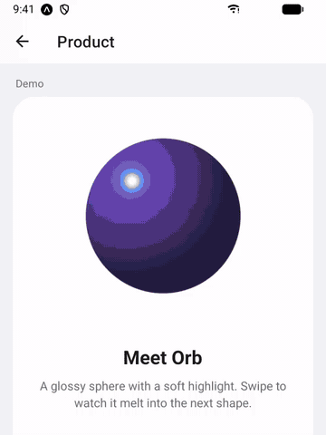

# expo-morph-carousel

[English](https://github.com/anhtuank7c/expo-morph-carousel/blob/main/README.md) | **Tiếng Việt**

Carousel cho Expo, trong đó các ảnh tan vào nhau như chất lỏng trong lúc các trang trượt. Dựng bằng React Native Skia và Reanimated 4, kèm các preset chuyển cảnh đơn giản hơn, loop, autoplay, trượt dọc, hỗ trợ trình đọc màn hình và web.

<p align="center">
  
</p>

## Tính năng

- **Liquid morph.** Giữa hai trang, ảnh hiện tại tan thành một khối lỏng rồi đông lại thành ảnh kế tiếp. Hiệu ứng được vẽ bằng Skia trên UI thread và tắt hẳn khi trang đứng yên, nên ảnh lúc nghỉ không bao giờ bị mờ.
- **Preset và hiệu ứng tự viết.** `crossfade`, `slide`, `parallax`, `stack`, hoặc một worklet của bạn nhận khoảng cách trang và trả về opacity, transform.
- **Hành vi pager quen thuộc.** Snap theo trang, mỗi lần vuốt một trang, vuốt nhanh (fling), co giãn ở hai đầu, `loop` theo cả hai chiều, trượt ngang hoặc `vertical`, hỗ trợ bố cục phải sang trái.
- **Autoplay** tạm dừng khi người dùng chạm vào carousel và khi trình đọc màn hình đang bật.
- **Điều khiển từ code.** `ref.scrollTo(index)`, `next()`, `prev()`, `onIndexChange`, một shared value phản chiếu vị trí để dùng cho animation khác, và render prop cho footer kèm item hiện tại.
- **Chấm phân trang biến hình** chạy theo ngón tay và bấm được.
- **Ảnh.** `require()` cục bộ hoặc `{ uri }` từ mạng, `contain` hoặc `cover`, màu placeholder cho từng item, ảnh lân cận được tải sẵn nên vuốt hiếm khi phải chờ.
- **Ảnh responsive.** Khai báo danh sách kích thước (`srcset`) hoặc dựng URL CDN theo kích thước đo được; carousel chọn ảnh phù hợp với vùng hiển thị và mật độ điểm ảnh, và sau khi xoay màn hình thì crossfade sang ảnh nét hơn mà không chớp.
- **Cache ảnh có thời hạn.** Ảnh từ mạng được lưu trên đĩa (Cache Storage trên web) với thời hạn lấy từ `maxAge` hoặc header `Cache-Control` của server. Mặc định là `stale-while-revalidate`: ảnh đã cache hiện ngay, ảnh hết hạn được kiểm tra lại bằng `ETag` (một phản hồi 304 không tốn byte ảnh nào) và được thay khi server có bản mới.
- **Accessibility.** Carousel là một phần tử adjustable: với VoiceOver hoặc TalkBack, vuốt lên hoặc xuống để đổi trang, item hiện tại được đọc lên. Trên web dùng phím mũi tên, Home và End. Khi bật Reduce Motion, hiệu ứng chuyển về cross-fade.
- **iOS, Android và web.** Chạy được trong Expo Go.

## Cài đặt

```bash
npx expo install expo-morph-carousel @shopify/react-native-skia expo-file-system \
  react-native-reanimated react-native-worklets react-native-gesture-handler
```

Hai gói trong số này là tuỳ chọn:

| Gói | Cần cho | Nếu không cài |
| --- | --- | --- |
| `@shopify/react-native-skia` | Hiệu ứng `liquid` (mặc định) | Carousel dùng `crossfade` |
| `expo-file-system` | Cache ảnh từ mạng trên đĩa ở iOS và Android | Ảnh từ mạng được tải lại mỗi lần (HTTP cache của nền tảng vẫn có tác dụng) |

`babel.config.js` phải dùng `babel-preset-expo`, preset này bật Babel plugin cho worklets. Bọc app trong `GestureHandlerRootView`.

### Web

Trên web, Skia chạy trên CanvasKit, một file WebAssembly mà app của bạn phải phục vụ. Chép nó vào `public/` một lần:

```bash
npx setup-skia-web public
```

Carousel tải CanvasKit ở nền và hiển thị cross-fade cho tới khi tải xong. Muốn tải file từ chỗ khác thì gọi `configureSkiaWeb({ locateFile: (file) => 'https://…/' + file })` trước khi carousel đầu tiên được render.

## Tương thích

| | Hỗ trợ |
| --- | --- |
| Expo SDK | 58 trở lên |
| React Native | 0.80 trở lên (New Architecture) |
| Reanimated | 4 trở lên, kèm `react-native-worklets` |
| React Native Skia | 2 trở lên (tùy chọn) |
| Nền tảng | iOS, Android, web |
| Expo Go | Có. Package không có native code riêng |

## Sử dụng

```tsx
import { MorphCarousel } from 'expo-morph-carousel';

const products = [
  { id: 'watch', title: 'Watch', description: '…', image: require('./assets/watch.png') },
  { id: 'phone', title: 'Phone', description: '…', image: require('./assets/phone.png') },
  { id: 'laptop', title: 'Laptop', description: '…', image: { uri: 'https://…/laptop.png' } },
];

export function Showcase() {
  return (
    <MorphCarousel
      data={products}
      keyExtractor={(p) => p.id}
      getImage={(p) => p.image}
      getAccessibilityLabel={(p) => p.title}
      style={{ height: 520, borderRadius: 28, backgroundColor: '#fff' }}
      renderItem={({ item }) => (
        <View style={{ alignItems: 'center', padding: 24, gap: 8 }}>
          <Text style={{ fontSize: 24, fontWeight: '700' }}>{item.title}</Text>
          <Text style={{ textAlign: 'center' }}>{item.description}</Text>
        </View>
      )}
      renderFooter={({ item, next }) => <Button title="Continue" onPress={next} />}
    />
  );
}
```

Carousel cần có kích thước: đặt `height` hoặc `flex: 1` trong `style`. Vùng media chiếm `mediaHeight` ở trên (hoặc cả carousel với `mediaPosition="background"`), các trang chiếm phần còn lại, chấm phân trang và footer nằm bên dưới.

Hiệu ứng liquid đẹp nhất với ảnh nền trong suốt như ảnh sản phẩm, icon hay hình minh họa, nơi đường viền của vật thể thay đổi giữa các trang. Với ảnh chụp (`mediaFit="cover"`), nó làm các hình chữ nhật tan vào nhau.

## Props

| Prop | Mặc định | Mô tả |
| --- | --- | --- |
| `data` | bắt buộc | Danh sách item |
| `getImage(item, index, target)` | bắt buộc | Ảnh cho vùng media: `require(...)`, `{ uri }`, danh sách biến thể `{ uri, width, height }`, hoặc URL dựng từ `target` (xem [Ảnh responsive](#ảnh-responsive-srcset)) |
| `renderItem({ item, index })` | | Nội dung trang, trượt theo cử chỉ |
| `keyExtractor(item, index)` | index | Key ổn định cho từng item |
| `effect` | `'liquid'` | `'liquid'`, `'crossfade'`, `'slide'`, `'parallax'`, `'stack'` hoặc một worklet (xem bên dưới) |
| `liquid` | | `{ blur = 28, threshold = 0.5, sharpness = 24 }`. `blur` lớn hơn cho khối tròn hơn; `threshold` thấp hơn giữ lại nhiều quầng mờ hơn |
| `mediaPosition` | `'top'` | `'top'` hoặc `'background'` |
| `mediaHeight` | `280` | Chiều cao vùng media khi nằm trên |
| `mediaFit` | `'contain'` | `'contain'` hoặc `'cover'` |
| `mediaPadding` | `16` | Khoảng cách quanh ảnh trong vùng media |
| `getPlaceholderColor(item, index)` | | Màu của khối mờ hiển thị khi ảnh đang tải |
| `imageCache` | bật | Tuỳ chọn cho ảnh từ mạng (xem [Ảnh từ mạng và cache](#ảnh-từ-mạng-và-cache)), hoặc `false` |
| `direction` | `'horizontal'` | `'horizontal'` hoặc `'vertical'` |
| `loop` | `false` | Vuốt qua trang cuối về trang đầu, và ngược lại |
| `initialIndex` | `0` | Trang hiển thị đầu tiên |
| `autoplay` | `false` | `true` hoặc `{ interval = 4000, reverse = false, whenScreenReaderEnabled = false }` |
| `windowSize` | `2` | Số trang được render và số ảnh được giữ tải ở mỗi bên trang hiện tại |
| `spring` | | `{ damping, stiffness, mass }` cho animation snap |
| `gestureEnabled` | `true` | Cho phép vuốt. Điều hướng qua `ref` vẫn hoạt động khi tắt |
| `pagination` | `true` | `false`, hoặc tuỳ chọn: `activeColor`, `inactiveColor`, `size`, `activeWidth`, `gap`, `pressable`, `style` |
| `renderFooter(api)` | | Nội dung dưới chấm phân trang. Nhận `item`, `index`, `count`, `position`, `scrollTo`, `next`, `prev` |
| `onIndexChange(index)` | | Gọi khi trang gần nhất thay đổi, kể cả trong lúc kéo |
| `positionValue` | | `SharedValue<number>` phản chiếu vị trí tính theo trang |
| `accessibilityLabel` | `'Carousel'` | Nhãn của carousel cho trình đọc màn hình |
| `getAccessibilityLabel(item, index)` | key | Văn bản đọc cho item hiện tại |
| `ref` | | `{ scrollTo(index, { animated }), next(), prev(), getIndex() }` |
| `style`, `mediaStyle`, `pageStyle`, `footerStyle`, `testID` | | |

## Ảnh responsive (srcset)

Carousel đo vùng media, nhân với mật độ điểm ảnh của thiết bị và chọn ảnh vừa đủ nét mà không tải thừa. Có hai cách khai báo các kích thước.

**Danh sách biến thể**, dạng `srcset` của React Native (`width` là `w`-descriptor):

```tsx
getImage={(p) => [
  { uri: `${p.base}-640.jpg`, width: 640, height: 480 },
  { uri: `${p.base}-1280.jpg`, width: 1280, height: 960 },
  { uri: `${p.base}-2560.jpg`, width: 2560, height: 1920 },
]}
```

Biến thể nhỏ nhất mà vẫn đủ rộng sẽ được chọn; nếu có `height`, `cover` và `contain` tính cả tỉ lệ khung hình. Biến thể đã có trong cache được ưu tiên nếu không lớn quá 2 lần mức cần.

**URL dựng theo kích thước**, cho các CDN ảnh (imgix, Cloudinary, Unsplash, resizer kiểu Next.js). Tham số thứ ba là kích thước cần, tính bằng pixel vật lý, làm tròn lên một trong vài bậc (`WIDTH_STEPS`: 320, 480, 640, 750, 828, 1080, 1200, 1440, 1920, 2560, …) để CDN và cache chỉ thấy vài URL cho mỗi ảnh, thay vì mỗi thiết bị một URL:

```tsx
getImage={(p, i, target) => ({
  uri: `https://images.unsplash.com/photo-${p.id}?w=${target.width}&h=${target.height}&fit=crop`,
})}
```

`target` gồm `width`, `height`, `pixelRatio`, `layoutWidth`, `layoutHeight` (dp) và `fit`.

Không cần `sizes`: HTML cần nó vì trình duyệt chọn ảnh trước khi layout, còn carousel chọn sau khi layout.

**Xoay màn hình và đổi kích thước.** Khi vùng ảnh lớn lên (dọc sang ngang, chia đôi màn hình, đổi cỡ cửa sổ trên web), biến thể nét hơn được tải ở nền trong khi ảnh hiện tại vẫn hiển thị, rồi crossfade trong 220 ms sau khi decode xong. Khi vùng ảnh nhỏ đi, ảnh nét đang hiện được giữ nguyên và không tải gì thêm, giống trình duyệt. Ảnh được vẽ lại theo kích thước mới ngay trong khung hình đổi layout, nên khi xoay không có khung nào vẽ theo kích thước cũ hay bị trống.

## Ảnh từ mạng và cache

Ảnh từ mạng (`{ uri: 'https://…' }`) đi qua một cache trên đĩa, bật sẵn mặc định. Mỗi ảnh được lưu kèm thời điểm tải và thời điểm hết hạn.

```tsx
// Hằng số ở cấp module (hoặc useMemo): carousel memo tuỳ chọn theo identity.
const CACHE = {
  strategy: 'stale-while-revalidate', // mặc định
  maxAge: 6 * 60 * 60 * 1000, // 6 giờ khi server không gửi Cache-Control
} as const;

<MorphCarousel imageCache={CACHE} getImage={(p) => ({ uri: p.imageUrl })} … />
```

| Chiến lược | Đã cache, còn hạn | Đã cache, hết hạn | Chưa cache |
| --- | --- | --- | --- |
| `stale-while-revalidate` (mặc định) | Hiện ngay, không gửi request | Hiện ngay, kiểm tra lại ở nền, thay ảnh nếu server có bản mới. Quá `maxStale` thì chờ mạng | Tải về |
| `cache-first` | Hiện ngay, không gửi request | Chờ mạng; bản cũ là phương án dự phòng khi mất mạng | Tải về |
| `network-first` | Kiểm tra lại trước khi hiện; bản đã cache là dự phòng khi mất mạng | Như cột bên | Tải về |

Thời hạn của ảnh:

- Nếu server gửi `Cache-Control: max-age` (hoặc `Expires`), dùng thời hạn đó. `no-cache` nghĩa là "luôn kiểm tra lại", `no-store` nghĩa là "không ghi xuống đĩa". Đặt `respectHttpHeaders: false` để luôn dùng `maxAge`.
- Nếu không, dùng `maxAge` (mặc định 24 giờ).

Khi kiểm tra lại, cache gửi `If-None-Match` / `If-Modified-Since`. Nếu ảnh không đổi, server trả 304 và không có dữ liệu ảnh nào được truyền. Nếu ảnh đã đổi, file mới mang tên mới nên view ảnh tải lại, và file cũ bị xoá. Ảnh đang nằm trên màn hình cũng được kiểm tra lại khi hết hạn, không chỉ lúc mount.

Tuỳ chọn của `imageCache`:

| Tuỳ chọn | Mặc định | Mô tả |
| --- | --- | --- |
| `strategy` | `'stale-while-revalidate'` | Xem bảng trên |
| `maxAge` | 24 giờ | Thời hạn (ms) khi server không gửi |
| `maxStale` | 7 ngày | `stale-while-revalidate` còn được hiện ảnh cũ bao lâu sau khi hết hạn, trong lúc chờ ảnh mới |
| `respectHttpHeaders` | `true` | Dùng `Cache-Control` / `Expires` và tuân theo `no-store` |
| `headers` | | Header cho request, ví dụ `Authorization` |
| `getCacheKey(url)` | URL | Cho URL ký (signed URL) có query đổi mỗi lần: `(url) => url.split('?')[0]` |

Truyền `imageCache={false}` để tải thẳng từ mạng.

Cache được dùng chung cho mọi carousel và có API để gọi từ code:

```ts
import { imageCache } from 'expo-morph-carousel';

imageCache.configure({ maxSize: 50 * 1024 * 1024, maxEntries: 300 }); // mặc định: 100 MB, 500 file, xoá theo LRU
await imageCache.prefetch(urls); // tải trước khi màn hình mở
imageCache.getEntry(url); // { fetchedAt, expiresAt, etag, size, … }
imageCache.stats(); // { hits, misses, revalidations, notModified, updates, errors, entries, size }
await imageCache.remove(url);
await imageCache.clear(); // ví dụ khi đăng xuất
```

File được lưu trong `<thư mục cache>/expo-morph-carousel/` trên iOS và Android (hệ điều hành có thể xoá khi thiếu dung lượng) và trong Cache Storage trên web. Ảnh đã decode cũng được giữ trong bộ nhớ (24 ảnh gần nhất), nên vuốt qua lại không phải decode lại.

Để thử, app ví dụ có một server ảnh local gửi `ETag` và `Cache-Control`, và có thể đổi ảnh:

```bash
npm run image-server --workspace example   # http://localhost:8090, max-age 30 giây
adb reverse tcp:8090 tcp:8090               # Android emulator
```

Mở "Remote images" trong app ví dụ. Bảng thông tin hiện thời điểm tải ảnh hiện tại, ảnh còn hạn bao lâu, và các bộ đếm của cache; nút "Swap images on server" đổi nội dung mà mọi URL trả về.

## Điều khiển carousel

```tsx
const carousel = useRef<MorphCarouselRef>(null);
const position = useSharedValue(0);

// Đổi màu nền theo item hiện tại trong lúc vuốt
const background = useAnimatedStyle(() => ({
  backgroundColor: interpolateColor(position.value, [0, 1, 2], ['#efe9ff', '#fff3df', '#e2f6f1']),
}));

<MorphCarousel ref={carousel} positionValue={position} onIndexChange={setIndex} … />
<Button title="Next" onPress={() => carousel.current?.next()} />
```

Khi `loop` tắt, `next()` ở trang cuối quay về trang đầu, đúng như nút "Next" và autoplay thường cần. Khi `loop` bật, `scrollTo(0)` từ trang cuối tiến thêm một trang thay vì tua ngược qua tất cả các trang.

## Hiệu ứng tự viết

Một hiệu ứng nhận khoảng cách có dấu từ trang của ảnh tới vị trí hiện tại (`offset`: 0 là đang hiển thị, -1 là lùi một trang, 0.5 là nửa đường tới trang sau) và trả về opacity, transform. Nó chạy trên UI thread nên phải là worklet:

```tsx
import type { MediaEffectFn } from 'expo-morph-carousel';

const flip: MediaEffectFn = ({ offset }) => {
  'worklet';
  const angle = Math.max(-1, Math.min(1, offset)) * 90;
  return {
    opacity: Math.abs(offset) < 0.5 ? 1 : 0,
    transform: [{ perspective: 800 }, { rotateY: `${angle}deg` }],
  };
};

<MorphCarousel effect={flip} … />
```

Đầu vào còn có `width`, `height`, `direction` và `rtl`. Các preset có sẵn được export dưới tên `mediaEffects` nếu bạn muốn bọc lại một preset.

## Chấm phân trang đặt ở chỗ khác

`<Pagination>` được export. Truyền cho nó cùng shared value:

```tsx
<MorphCarousel pagination={false} positionValue={position} ref={carousel} … />
<Pagination count={data.length} position={position} onPress={(i) => carousel.current?.scrollTo(i)} />
```

## Hiệu ứng liquid hoạt động thế nào

Mọi ảnh gần trang hiện tại được xếp chồng trong một layer Skia và cross-fade theo khoảng cách trang. Sau đó layer đi qua hai bộ lọc:

1. Blur, với bán kính đạt đỉnh ở giữa hai trang. Hai ảnh tan vào nhau thành một hình mềm.
2. Alpha threshold, tức một color matrix trên kênh alpha, cắt viền mờ về lại một đường viền sắc. Hình mềm trở thành một khối đặc thay vì một đám mờ.

Cả hai bộ lọc tỉ lệ theo một đường tam giác: bằng 0 khi ở đúng trang và bằng 1 ở giữa hai trang, nên trang đứng yên được vẽ nguyên vẹn. Các trang chữ là view React Native thông thường và trượt; chỉ vùng media được vẽ bằng Skia.

## Accessibility

- Vùng media và các trang tạo thành một phần tử với role `adjustable` (`slider` trên web). Người dùng VoiceOver và TalkBack vuốt lên hoặc xuống để đổi trang; giá trị được đọc như "Watch, 1 / 3".
- Footer nằm ngoài phần tử đó nên các nút bên trong vẫn truy cập được.
- Autoplay dừng khi trình đọc màn hình đang bật, trừ khi đặt `autoplay.whenScreenReaderEnabled`.
- Khi bật Reduce Motion, `liquid` và các preset khác chuyển về `crossfade`, và snap không có animation.
- Trên web carousel nhận focus được: phím mũi tên chuyển một trang (lên/xuống khi trượt dọc), Home và End về hai đầu.

## Hiệu năng

- Chỉ `windowSize` trang mỗi bên được render; phần còn lại của `data` không tốn gì.
- Gesture, snap, hiệu ứng và chấm phân trang chạy trên UI thread. React chỉ render lại khi trang gần nhất thay đổi.
- Bộ lọc Skia chỉ được tạo trong lúc đang chuyển trang. Khi đứng yên, layer chỉ là một lần vẽ ảnh.
- Giữ ảnh gần với kích thước hiển thị. Ảnh 4000 px bị blur mỗi frame sẽ nặng trên điện thoại Android cũ; giảm `liquid.blur` cũng giúp.

## Xử lý sự cố

| Triệu chứng | Nguyên nhân và cách sửa |
| --- | --- |
| Không thấy gì | Carousel không có chiều cao. Đặt `style={{ height: … }}` hoặc `flex: 1` trong một parent có kích thước |
| Thấy cross-fade thay vì liquid | Chưa cài Skia, đang bật Reduce Motion, hoặc (web) CanvasKit chưa tải xong. Kiểm tra `public/canvaskit.wasm` đã có chưa (`npx setup-skia-web public`) |
| Vuốt lại cuộn ScrollView cha | Carousel ngang nhận cử chỉ kéo ngang quá 10 px; kéo dọc thuộc về parent. Carousel dọc trong ScrollView dọc thì đặt chiều cao cố định cho carousel và chấp nhận hai bên tranh nhau cử chỉ |
| Lỗi worklet như "… is not a worklet" | Hiệu ứng tự viết thiếu `'worklet';`, hoặc `babel.config.js` không dùng `babel-preset-expo`. Xoá cache Metro bằng `npx expo start -c` |
| Ảnh từ mạng mãi là placeholder | Tải ảnh thất bại; `imageCache.stats().errors` đếm số lần lỗi. Trên Android, lỗi HTTPS (ví dụ chứng chỉ của proxy) hiện trong logcat dưới dạng `System.err`. URL `http://` không mã hoá cần `usesCleartextTraffic` ở bản release |
| Ảnh đã cập nhật trên server mà app chưa hiện | Ảnh vẫn còn hạn: giảm `maxAge`, cho server gửi `Cache-Control: max-age` ngắn hơn, hoặc gọi `imageCache.remove(url)` |

## Trạng thái nền tảng

| Nền tảng | Đã kiểm tra bằng |
| --- | --- |
| Android | Emulator Android 17 (API 37), Expo Go: mọi hiệu ứng, loop, trượt dọc, chấm phân trang, ref API, và cache trên đĩa với server ảnh local (dùng cache khi còn hạn, kiểm tra lại bằng 304, thay ảnh sau khi hết hạn, giữ cache qua các lần mở lại app) |
| Web | Chrome desktop: hiệu ứng liquid với CanvasKit, điều hướng bằng bàn phím, ảnh từ mạng, cache bằng Cache Storage qua các lần tải lại trang |
| iOS | Chưa kiểm tra |

Hoan nghênh các báo cáo từ iOS.

## Phát triển

```bash
npm install
npm run example          # app ví dụ trong Expo Go
npm run check            # typecheck, ESLint, Prettier, unit test
npm test                 # chỉ unit test cho phần toán phân trang
npm run build            # biên dịch ra lib/
```

App ví dụ (`example/`) import package từ `src/` và có bốn màn: trưng bày sản phẩm, onboarding toàn màn hình, playground cho mọi tuỳ chọn và thư viện ảnh từ mạng. Các hình trong ví dụ được tạo bằng `npm run make-assets --workspace example` (cần ffmpeg).

`npm install` cũng cài một pre-commit hook chạy ESLint và Prettier trên các file đã stage và chạy typecheck.

## Đóng góp và báo lỗi

- Lỗi: mở issue bằng [form báo lỗi](https://github.com/anhtuank7c/expo-morph-carousel/issues/new?template=bug_report.yml).
- Ý tưởng và câu hỏi: [đề xuất tính năng](https://github.com/anhtuank7c/expo-morph-carousel/issues/new?template=feature_request.yml) hoặc [Discussions](https://github.com/anhtuank7c/expo-morph-carousel/discussions).
- Pull request: xem [CONTRIBUTING.md](https://github.com/anhtuank7c/expo-morph-carousel/blob/main/CONTRIBUTING.md).
- Lỗi bảo mật: xem [SECURITY.md](https://github.com/anhtuank7c/expo-morph-carousel/blob/main/SECURITY.md).
- Ghi chú phát hành: [CHANGELOG.md](https://github.com/anhtuank7c/expo-morph-carousel/blob/main/CHANGELOG.md).

Cùng tác giả: [expo-morph-menu](https://github.com/anhtuank7c/expo-morph-menu), một nút nổi biến hình thành menu và thành các route toàn màn hình.

## Giấy phép

MIT
