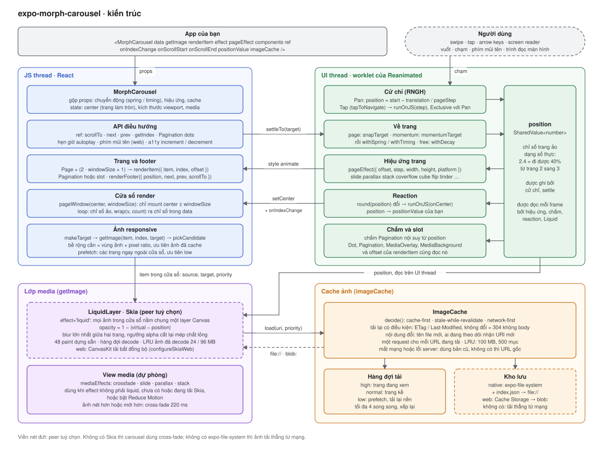
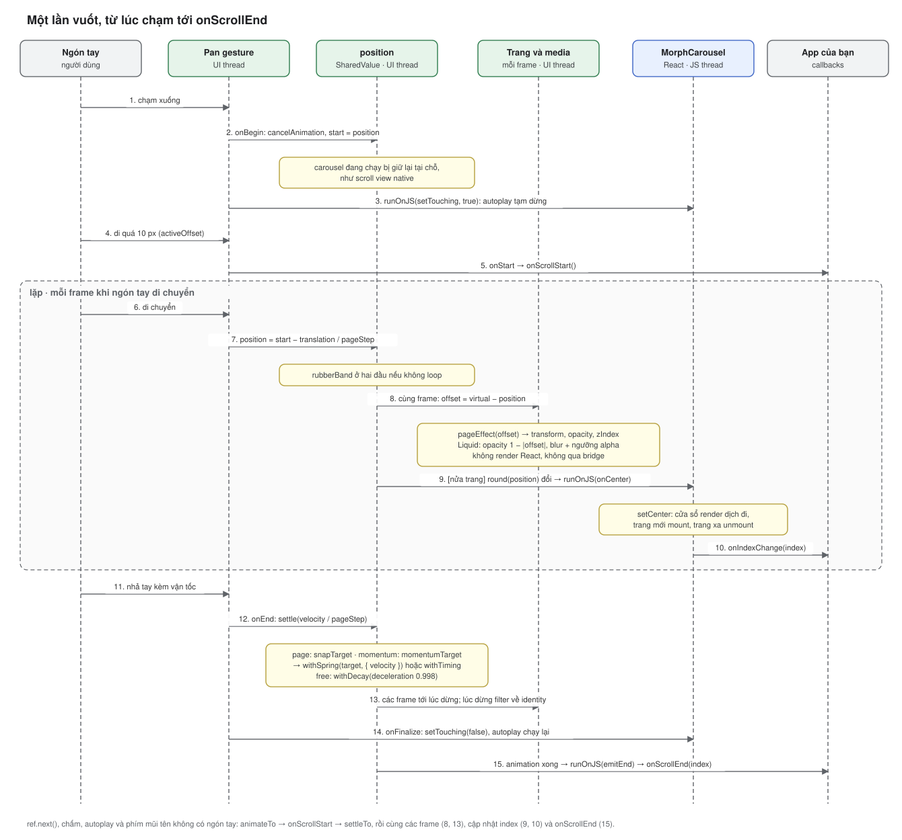
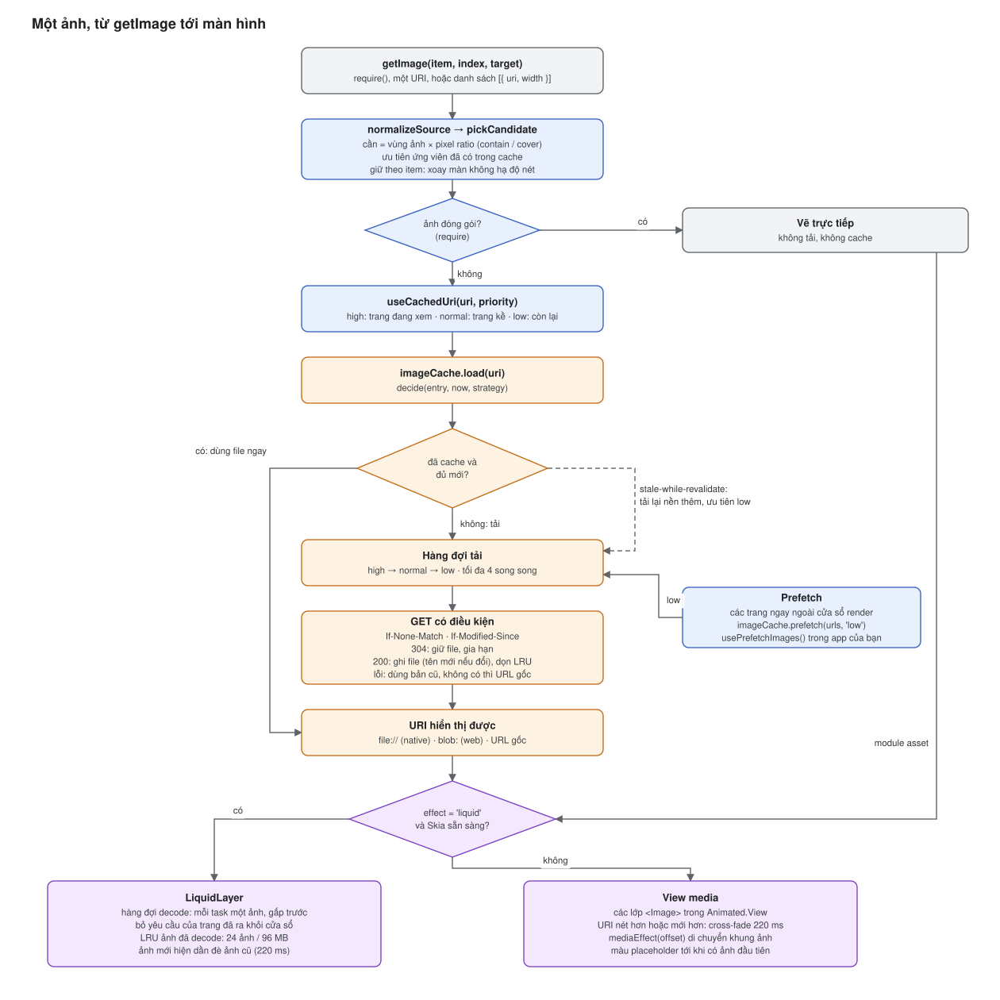

# Kiến trúc

[English](ARCHITECTURE.md)

Trang này mô tả `expo-morph-carousel` được dựng thế nào, và chuyện gì xảy ra trong một lần vuốt và khi một ảnh được tải. Các sơ đồ là file `.drawio.svg`: GitHub hiển thị chúng như ảnh, còn [draw.io](https://www.drawio.com/) (app desktop, hoặc extension "Draw.io Integration" của VS Code) mở chính file đó để sửa. Khi lưu từ draw.io, chọn SVG và bật "Include a copy of my diagram" để file vẫn sửa được.

## Các khối chính

Carousel gồm bốn phần.

- **JS thread (React).** `MorphCarousel` biến props thành một cửa sổ render: chỉ `center ± windowSize` trang được mount. Nó giữ API điều hướng (`ref.scrollTo`, `next`, `prev`, `getIndex`), autoplay, phím mũi tên trên web và các thao tác trợ năng. Nó cũng chọn ứng viên ảnh cho từng trang và prefetch ảnh của các trang ngay ngoài cửa sổ.
- **UI thread (Reanimated).** Một shared value, `position`, giữ chỉ số trang ảo dạng số thực (`2.4` là đã đi được 40% từ trang 2 sang trang 3). Cử chỉ pan ghi nó khi ngón tay di chuyển, animation về trang (`withSpring`, `withTiming` hoặc `withDecay`) ghi nó sau khi nhả tay. Hiệu ứng trang, chấm phân trang, các slot và lớp liquid đọc nó mỗi frame. React chỉ render lại khi trang gần nhất thay đổi.
- **Lớp media.** Với `effect="liquid"` và đã cài React Native Skia, mọi ảnh trong cửa sổ được vẽ chung một layer Skia. Mỗi ảnh có opacity `1 − |virtual − position|`, và layer đi qua một bộ blur lớn nhất ở giữa hai trang cùng một ngưỡng alpha cắt mép mờ lại thành đường viền sắc. Không có Skia, dùng `effect` khác, hoặc bật Reduce Motion thì carousel dùng view thường với một media effect (`crossfade`, `slide`, `parallax`, `stack`).
- **Cache ảnh.** Ảnh từ mạng đi qua `imageCache`: cache có hạn dùng, request có điều kiện, hàng đợi tải có ưu tiên và kho lưu trên đĩa (`expo-file-system` trên native, Cache Storage trên web).

Skia và `expo-file-system` là peer tuỳ chọn. Không có Skia thì carousel cross-fade các ảnh, không có `expo-file-system` thì ảnh tải thẳng từ mạng.

### Các thread

| Chạy trên | Việc gì | Mã nguồn |
| --- | --- | --- |
| UI thread | Cử chỉ pan và tap, `position`, animation về trang, hiệu ứng trang, media effect, chấm phân trang, layer Skia | `src/MorphCarousel.tsx`, `src/pageEffects.ts`, `src/effects.ts`, `src/Pagination.tsx`, `src/liquid/createLiquidLayer.tsx` |
| JS thread | Props, cửa sổ render, `renderItem`, API điều hướng, autoplay, trợ năng, chọn ứng viên ảnh, decode ảnh (mỗi task một ảnh) | `src/MorphCarousel.tsx`, `src/responsive.ts`, `src/useResponsiveImage.ts`, `src/liquid/decodeQueue.ts` |
| Nền (I/O) | Tải ảnh, file trên đĩa, Cache Storage trên web | `src/cache/` |

JS thread không tham gia frame nào của một lần vuốt. Nó chỉ được gọi khi trang gần nhất thay đổi (`runOnJS(onCenter)`), để dịch cửa sổ render và báo `onIndexChange`.

## Một lần vuốt

1. **Chạm xuống.** `onBegin` huỷ animation đang chạy, nên chạm vào carousel đang chuyển động sẽ giữ nó lại tại chỗ, như scroll view native. Autoplay tạm dừng khi ngón tay còn trên màn hình.
2. **Ngón tay di quá 10 px** theo trục cuộn (`activeOffset`). Pan được kích hoạt và `onScrollStart` được gọi. Nếu di 14 px theo trục vuông góc trước thì pan bị huỷ, nên danh sách dọc bọc ngoài một carousel ngang vẫn cuộn được.
3. **Mỗi frame khi ngón tay di chuyển**, `position = start − translation / pageStep`. Không có `loop` thì `rubberBand` tạo lực cản khi kéo quá trang đầu và trang cuối. Trong cùng frame đó, mỗi trang tính `offset = virtual − position` và hiệu ứng trang trả về transform, opacity và z-index; lớp liquid đặt opacity cho từng ảnh và chọn paint cho bước chuyển hiện tại.
4. **Đi được nửa trang**, `Math.round(position)` đổi. Một reaction gọi `onCenter` trên JS thread: cửa sổ render dịch đi (một trang mới mount ở một đầu, trang xa nhất unmount ở đầu kia) và `onIndexChange` được gọi.
5. **Nhả tay.** Vận tốc tính theo trang mỗi giây quyết định đích: một trang theo hướng vuốt (`snapMode="page"`), xa tới đâu tuỳ tốc độ (`"momentum"`), hoặc không có đích (`"free"`, một chuyển động decay với độ giảm tốc của scroll view native). Spring bắt đầu với vận tốc của ngón tay, nên lúc nhả tay không bị giật.
6. **Lúc dừng hẳn**, các filter liquid về identity (ảnh được vẽ nguyên vẹn), autoplay chạy lại bộ hẹn giờ và `onScrollEnd` được gọi.

`ref.next()`, các chấm, autoplay và phím mũi tên đi cùng đường đó nhưng không có ngón tay: `animateTo` gọi `onScrollStart`, rồi `settleTo` chạy cùng animation, reaction và callback.

## Một ảnh

1. **`getImage(item, index, target)`** trả về một ảnh đóng gói (`require`), một URI, hoặc danh sách ứng viên kèm bề rộng. `target` là vùng vẽ nhân pixel ratio, làm tròn về vài mức bề rộng, nên dùng được để dựng URL CDN.
2. **Chọn ứng viên.** Carousel chọn ứng viên nhỏ nhất mà vẫn đủ rộng (không cái nào đủ thì lấy cái rộng nhất). Ứng viên đã có trong cache và rộng không quá hai lần mức cần được ưu tiên, để khỏi tải mới. Lựa chọn được giữ theo từng item: xoay màn sang vùng nhỏ hơn thì ảnh nét hơn vẫn ở lại.
3. **Ảnh đóng gói** được vẽ trực tiếp. Ảnh từ mạng đi qua `useCachedUri(uri, priority)`: `high` cho trang đang xem, `normal` cho trang kề, `low` cho các trang còn lại.
4. **`imageCache.load`** quyết định dựa trên mục trong cache và chiến lược. Mục còn mới thì hiện file ngay; với `stale-while-revalidate` và mục đã cũ thì hiện ngay và tải lại ở nền với ưu tiên `low`; còn lại thì tải về.
5. **Hàng đợi tải** chạy tối đa 4 lượt tải cùng lúc, gấp nhất trước, và xếp lại các yêu cầu đang chờ khi một cú vuốt nhanh làm ưu tiên thay đổi. Các yêu cầu đồng thời cho cùng một URL dùng chung một lượt tải. Prefetch (các trang ngay ngoài cửa sổ, `imageCache.prefetch`, `usePrefetchImages`) chạy với `low`.
6. **Request có điều kiện** (`If-None-Match`, `If-Modified-Since`): ảnh không đổi chỉ tốn một phản hồi 304 không có body và được gia hạn. Ảnh đã đổi được ghi với tên file mới, nên view ảnh tải lại. Vượt 100 MB hoặc 500 mục thì các mục lâu không dùng nhất bị xoá. Khi mất mạng, bản cũ được hiển thị, không có thì dùng URL gốc.
7. **Lên màn hình.** Lớp liquid decode mỗi JS task một ảnh, gấp nhất trước, và bỏ yêu cầu của các trang đã ra khỏi cửa sổ; ảnh đã decode được giữ trong một LRU (24 ảnh hoặc 96 MB). Lớp view dùng `<Image>`. Cả hai cho ảnh nét hơn hoặc mới hơn hiện dần đè lên ảnh cũ trong 220 ms, và hiện màu placeholder cho tới khi có ảnh đầu tiên.

## Các file

| Đường dẫn | Vai trò |
| --- | --- |
| `src/MorphCarousel.tsx` | Component chính: props, position, cử chỉ, điều hướng, cửa sổ render, trang, media, footer |
| `src/math.ts` | Phép tính phân trang thuần: `snapTarget`, `momentumTarget`, `rubberBand`, `pageWindow`, `wrap`, `nearestVirtual`, `tapDirection` |
| `src/pageEffects.ts` | Bố cục trang (worklet): slide, parallax, stack, coverflow, cube, flip, fade, scale-fade, rotate, tinder |
| `src/effects.ts` | Media effect cho lớp view: crossfade, slide, parallax, stack |
| `src/liquid/` | Layer liquid Skia, hàng đợi decode, tải CanvasKit trên web |
| `src/responsive.ts`, `src/useResponsiveImage.ts` | Target ảnh, chọn ứng viên, đổi ảnh không chớp |
| `src/cache/` | `ImageCache`, chính sách độ mới, hàng đợi tải, kho lưu cho native và web |
| `src/Pagination.tsx` | Chấm mặc định |
| `test/` | Unit test cho phép tính phân trang, chọn ứng viên, cache, hàng đợi tải, hàng đợi decode và cube |
